<!-- ────────────────────────────────────────────────────────────────
     Designed & built by Sainudheen · animated assets generated by
     tools/readme-assets/build.mjs  (edit there, not the SVGs)
     ──────────────────────────────────────────────────────────────── -->

<div align="center">




<br />

<a href="https://github.com/sainudheenp?tab=followers"></a>
<a href="https://github.com/sainudheenp"></a>

<a href="https://sainudheen.tech"></a>


</div>

## 👋 `whoami`

```bash
$ whoami
sainudheen — full-stack developer · Oman (UTC+4) · open to collaborate

$ cat focus.json
{
  "build":   ["React", "Next.js", "TypeScript", "Go", "Node.js"],
  "explore": ["NDC", "GDS", "airline retailing", "travel APIs"],
  "believe": "the best interfaces make complicated systems feel obvious"
}
```

I build web products end to end — the screens people touch and the plumbing
behind them. Outside of shipping features, I'm **reverse-engineering how travel
gets sold**: how an airline offer travels through distribution and finally
appears as a seat on someone's phone at 2 a.m.

<br />



<br />

## 🧭 Current itinerary — what I'm exploring

<table>
<tr>
<td width="33%" valign="top" align="left">

### 📦 NDC
**New Distribution Capability**

The airline-led shift from "here is a fare class" to "here is a rich offer" —
personalised, priced in real time and delivered over modern REST/JSON instead
of a 40-year-old messaging format.

Exploring:

- Offer → Order → Order Management lifecycle
- Rich content, ancillaries and branded fares
- Airline retailing APIs vs. the old EDIFACT world

</td>
<td width="33%" valign="top" align="left">

### 🌐 GDS
**Global Distribution System**

The rails agencies and OTAs have used for decades — Amadeus, Sabre and
Travelport — where a **PNR** is the record of a trip and *every* message is a
transaction.

Exploring:

- PNR anatomy, segments, SSR/OSI, ticketing
- Availability / shopping and fare rules
- How GDS content and NDC content sit side by side

</td>
<td width="33%" valign="top" align="left">

### ✈️ Travel tech
**Where the two meet**

The part I actually enjoy: building thin, fast products on top of heavy
industry plumbing — search, booking, and everything that breaks in between.

Exploring:

- Searching flights across mixed content sources
- Pricing, ancillaries and post-booking flows
- Mapping messy supplier payloads into one clean model

</td>
</tr>
</table>

<br />

## 📚 The glossary I'm building in public

The vocabulary that turns travel from "a black box" into something you can ship.

| Term | What it actually means | Why it matters |
| :--- | :--- | :--- |
| **Offer / Order** | An offer is a priced proposal; an order is the committed purchase | NDC replaces "book then wait" with a real e-commerce model |
| **PNR** | Passenger Name Record — the classic booking container | Still the source of truth across most of the industry |
| **ONE Order** | The ambition to collapse ticket + PNR + EMD into one order | Removes a whole layer of reconciliation pain |
| **EDIFACT** | The legacy message standard (Type A/AA, TTY channels) | Still everywhere — new builds must bridge *both* worlds |
| **Ancillaries** | Bags, seats, lounge, insurance sold alongside the fare | Most of the margin lives here, not in the ticket |
| **Branded fares** | Named fare families with different rules and inclusions | Makes comparison shopping possible across sources |
| **Shopping** | Requesting and ranking available itineraries | The hardest UX *and* latency problem in the stack |
| **Direct connect** | Talking to an airline's own API instead of via an aggregator | More content and control, more integration surface |
| **NDC Level 1–4** | Capability tiers airlines implement over time | Tells you what a given airline can actually support |
| **Ticketing / EMD** | Issuing the document that proves the purchase | Where money and accounting become real |

<br />

## 🗺️ Learning roadmap

```text
NDC & airline retailing   ██████████░░░░░░░░░░  ~50%
GDS messaging & PNR       ███████░░░░░░░░░░░░░  ~35%
Flight search UX          ████████████░░░░░░░░  ~60%
Post-booking flows        █████░░░░░░░░░░░░░░░  ~25%
```

- [x] Map how an offer becomes a booking (offer → order → ticket)
- [x] Build a search UI on top of a mock flight-inventory API
- [ ] Implement a supplier-agnostic flight model (normalise NDC + GDS shapes)
- [ ] Wire a full offer → order flow against a sandbox (Amadeus / Duffel-style)
- [ ] Write up the EDIFACT ⇄ JSON bridge in plain language for other devs

<br />

## 🛠️ The stack I reach for

<div align="center">

**Languages**


**Frontend**


**Backend & data**


**Tooling**


</div>

<br />

## 🚀 Selected builds

<table>
<tr>
<td width="50%" valign="top">

**[🧾 InvoiceKit](https://github.com/sainudheenp/invoice-kit)** · [live](https://invoicekitz.netlify.app/)
Client-side invoices, quotations and receipts — real vector PDFs, IndexedDB
storage, zero backend. Your data never leaves the device.
`TypeScript` `Vite`

</td>
<td width="50%" valign="top">

**[📊 Track Coder](https://github.com/sainudheenp/Track_Coder)**
Local-first coding analytics: typing speed, code time, streaks and goals —
exportable, offline-friendly, no dashboard subscription required.
`Python`

</td>
</tr>
<tr>
<td width="50%" valign="top">

**[✅ Smart Task Manager](https://github.com/sainudheenp/smart-task-manager)** · [live](https://smart-task-manager-gray.vercel.app)
Full-stack task management with categories, filters and a responsive UI built
on the Next.js App Router.
`Next.js` `TypeScript`

</td>
<td width="50%" valign="top">

**[🛒 Go E-Commerce](https://github.com/sainudheenp/goecom)**
JWT auth, product catalogue, cart and orders — a compact Go backend showing
how little you need to ship a solid product API.
`Go` `PostgreSQL`

</td>
</tr>
</table>

<br />

## 📊 Flight log

<div align="center">


</div>

<br />


## 🤝 Cleared for boarding

I'm open to collaborating on **full-stack products**, **travel/booking
experiences**, and anything where an ugly API needs a beautiful front door.

<div align="center">

<a href="https://github.com/sainudheenp"></a>
<a href="https://sainudheen.tech"></a>
<!-- Add your socials here when you're ready:
<a href="mailto:you@example.com"></a>
<a href="https://linkedin.com/in/your-handle"></a>
<a href="https://x.com/your-handle"></a>
-->

<br />


<sub><i>“Every great product is a well-hidden complexity.”</i></sub>

</div>

<!-- Made with care: the SVGs in assets/readme/ are hand-generated animations,
     rebuild them with `node tools/readme-assets/build.mjs` after editing. -->
