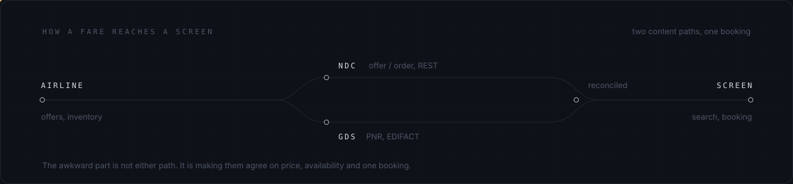

Full-stack developer in Oman. I build web products end to end — the interface
people use and the plumbing behind it. My current interest is the unglamorous
middle of the travel industry: how an airline's offer actually reaches a
booking screen.

 

## What I'm working through

**NDC** is airlines taking distribution back in-house: rich offers priced in
real time, delivered over REST/JSON as an offer → order lifecycle, instead of a
fare class buried in a legacy message. **GDS** is the opposite inheritance —
Amadeus, Sabre and Travelport, where the PNR is still the record of a trip and
every interaction is a transaction. Most real systems now carry both, and the
hard part is making them agree on price, availability, and one booking.

What I'm actually doing about it:

- Building a supplier-agnostic flight model so NDC and GDS payloads normalise into one shape
- Working through the offer → order → ticket path against sandbox APIs
- Learning the legacy side on purpose — EDIFACT and PNR semantics aren't going away
- Writing down the vocabulary as I go, because most of it is undocumented in plain language

<table>
<tr>
<td width="50%" valign="top">

**Terms I've had to actually understand**

| | |
| :--- | :--- |
| Offer / Order | A priced proposal; then the committed purchase |
| PNR | The booking record most of the industry still runs on |
| ONE Order | The push to collapse ticket, PNR and EMD into a single order |
| EDIFACT | The legacy message standard every new build still bridges |
| Ancillaries | Bags, seats, insurance — where most of the margin is |
| Branded fares | Named fare families, so offers can be compared at all |
| Shopping | Requesting and ranking itineraries; hardest part of the stack |
| Direct connect | Airline API instead of aggregator: more control, more surface |

</td>
<td width="50%" valign="top">

**Tooling**

| | |
| :--- | :--- |
| Languages | TypeScript, JavaScript, Python, Go, PHP, Dart |
| Frontend | React, Next.js, Vue, Tailwind, Sass, Flutter |
| Backend | Node.js, GraphQL, PostgreSQL, MongoDB, Redis, Laravel |
| Ops | Docker, Git, Linux, Vercel |

**Elsewhere**

[github.com/sainudheenp](https://github.com/sainudheenp) ·
[sainudheen.tech](https://sainudheen.tech)

</td>
</tr>
</table>

## Selected work

| Project | What it is | Built with |
| :--- | :--- | :--- |
| **[InvoiceKit](https://github.com/sainudheenp/invoice-kit)** · [live](https://invoicekitz.netlify.app/) | Invoices, quotations and receipts generated entirely in the browser — real vector PDFs, stored locally in IndexedDB, no backend, data never leaves the device. | TypeScript, Vite |
| **[Track Coder](https://github.com/sainudheenp/Track_Coder)** | Local-first coding analytics: typing speed, code time, streaks, goals. Works offline, exports its own reports. | Python |
| **[Smart Task Manager](https://github.com/sainudheenp/smart-task-manager)** · [live](https://smart-task-manager-gray.vercel.app) | Full-stack task management with categories, filters and a responsive UI on the Next.js App Router. | Next.js, TypeScript |
| **[Go E-Commerce](https://github.com/sainudheenp/goecom)** | JWT auth, catalogue, cart and orders — a deliberately small Go backend that still behaves like a real product API. | Go, PostgreSQL |

## Contact

Open to working on web products, booking and search experiences, or anything
where a difficult API needs a clear interface. The fastest route is a GitHub
issue or a message through [sainudheen.tech](https://sainudheen.tech).

<!--
  The two SVGs above are generated, not hand-written:
    node tools/readme-assets/build.mjs
  Preview the whole page locally:
    cd tools/readme-assets && npm install && npm run serve
-->
